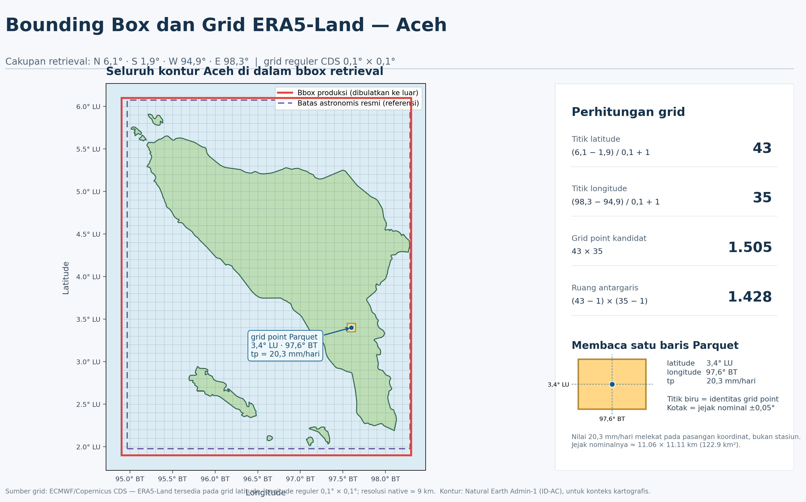
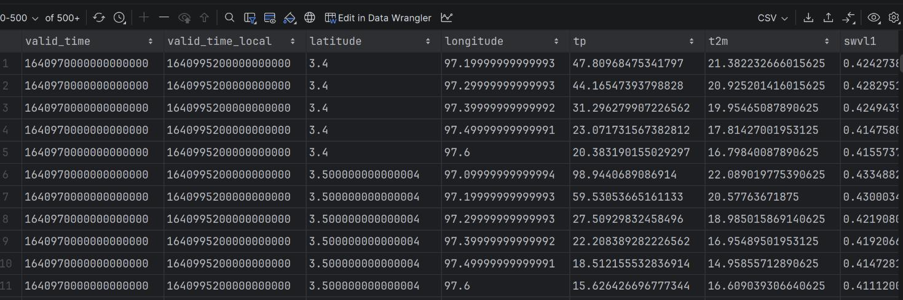

# Keputusan Desain Pengolahan CDS ERA5-Land

## 1. Tujuan dan pembaca dokumen

Dokumen ini menjelaskan keputusan yang digunakan untuk mengubah data **CDS ERA5-Land per jam** menjadi data harian yang siap disimpan dan dianalisis. Pembacanya tidak harus memahami pemrograman. Istilah teknis hanya digunakan ketika diperlukan dan dijelaskan bersama maknanya.

Ruang lingkup aktif proyek adalah:

```text
CDS ERA5-Land per jam
    → NetCDF mentah
    → pemeriksaan data mentah
    → perhitungan hari lokal UTC+7
    → Parquet harian
    → PostgreSQL
    → akses hanya-baca untuk analisis
```

Setiap bagian membedakan empat hal:

- **fakta ERA5-Land**, yaitu karakteristik data menurut Copernicus/ECMWF;
- **keputusan proyek**, yaitu cara proyek menafsirkan dan mengolah data;
- **evaluasi melalui test**, yaitu pemeriksaan bahwa program menerapkan keputusan tersebut;
- **batasan**, yaitu hal yang belum dijamin oleh sistem.

Test tidak menggantikan dasar ilmiah. Dokumentasi Copernicus/ECMWF menjelaskan bagaimana ERA5-Land harus ditafsirkan, sedangkan test membuktikan bahwa program mengikuti penafsiran yang telah ditetapkan.

---

## 2. Data yang digunakan: CDS ERA5-Land

ERA5-Land adalah dataset reanalysis yang menggambarkan perkembangan kondisi permukaan daratan selama beberapa dekade. Dataset ini menjalankan kembali komponen daratan ERA5 pada resolusi yang lebih tinggi, dengan masukan atmosfer dari ERA5. Menurut dokumentasi resmi, resolusi asli ERA5-Land sekitar 9 km dan data pada CDS disediakan pada grid latitude-longitude reguler 0,1° × 0,1°. Data tersedia per jam sejak Januari 1950.

**Keputusan proyek.** Sumber aktif pipeline hanya `reanalysis-era5-land` dari Copernicus Climate Data Store (CDS). Pipeline menggunakan produk per jam, bukan produk daily statistics yang sudah dihitung oleh CDS.

**Alasan ilmiah dan praktis.** Produk per jam memungkinkan proyek membentuk hari berdasarkan UTC+7, memeriksa apakah seluruh jam tersedia, dan menerapkan aturan yang berbeda untuk variabel keadaan dan variabel akumulasi. Produk daily statistics CDS dapat menghitung statistik harian pada zona waktu lokal, tetapi katalog tersebut tidak menyediakan parameter akumulasi ERA5-Land seperti total presipitasi. Karena proyek memerlukan variabel keadaan dan akumulasi dalam satu kontrak data, data per jam dipertahankan sebagai sumber utama.

Data ini tetap merupakan keluaran model pada suatu sel grid. Sebuah nilai tidak boleh dianggap sama dengan pengamatan alat pada satu titik. Dokumentasi CDS juga mengingatkan bahwa pengamatan lapangan dapat mewakili ruang dan waktu yang lebih lokal daripada rata-rata suatu sel model.

**Evaluasi melalui test.** Test permintaan memastikan bahwa program hanya menerima dataset ERA5-Land, menggunakan nama variabel yang disepakati, meminta 24 waktu UTC setiap hari, dan menolak interval unduhan langsung yang melintasi bulan kalender (`tests/unit/test_config_requests.py`, `tests/unit/test_extract.py`, dan `tests/unit/test_utils_request_validation.py`).

Sumber utama bagian ini:

- [ERA5-Land hourly data from 1950 to present](https://cds.climate.copernicus.eu/datasets/reanalysis-era5-land)
- [ERA5-Land: data documentation](https://confluence.ecmwf.int/display/CKB/ERA5-Land%3A+data+documentation)
- [ERA5 family post-processed daily statistics documentation](https://confluence.ecmwf.int/display/CKB/ERA5+family+post-processed+daily+statistics+documentation)

---

## 3. Gambaran perjalanan data

Pipeline mempertahankan dua bentuk file sebelum data dimuat ke database:

| Tahap | Bentuk | Makna |
|---|---|---|
| RAW | NetCDF | Salinan lokal data per jam dari CDS, termasuk konteks waktu yang diperlukan untuk perhitungan |
| Transformed | Parquet | Hasil harian UTC+7 setelah agregasi, konversi satuan, dan validasi |

**Keputusan proyek.** NetCDF RAW dipertahankan sebagai sumber ilmiah lokal dan tidak ditimpa. Parquet diperlakukan sebagai hasil yang dapat dibentuk kembali dari RAW menggunakan aturan transformasi yang sama.

**Alasan.** Pemisahan ini memungkinkan pemeriksaan ulang ketika rumus atau kode berubah. Tanpa RAW, hasil harian akan sulit ditelusuri kembali ke nilai per jam yang digunakan.

Contoh sederhana:

```text
Permintaan 1–3 Januari 2022
    → RAW berisi data per jam dan konteks 31 Desember
    → transformed hanya berisi hari lokal 1–3 Januari
    → PostgreSQL menyimpan metadata partisi dan observasi grid-hari
```

**Evaluasi melalui test.** Test runtime memeriksa urutan unduh atau resume, validasi RAW, transformasi atau resume, validasi hasil harian, dan penyerahan artefak yang benar ke pemuat database (`tests/unit/test_runtime.py`).

---

## 4. Pemilihan variabel dan satuan

Pipeline menerima lima variabel ERA5-Land:

| Kode | Makna | Sifat nilai per jam | Hasil harian | Satuan hasil |
|---|---|---|---|---|
| `tp` | total precipitation | akumulasi sejak awal forecast 00:00 UTC | total | mm/hari |
| `ssrd` | surface solar radiation downwards | akumulasi sejak awal forecast 00:00 UTC | total | J/m²/hari |
| `t2m` | temperatur udara 2 meter | keadaan pada waktu tertentu | rata-rata | °C |
| `d2m` | temperatur titik embun 2 meter | keadaan pada waktu tertentu | rata-rata | °C |
| `swvl1` | kandungan air volumetrik tanah lapisan 1, kedalaman 0–7 cm | keadaan pada waktu tertentu | rata-rata | m³/m³ |

**Keputusan proyek.** Kode pendek resmi (`tp`, `ssrd`, `t2m`, `d2m`, dan `swvl1`) dipertahankan pada RAW dan Parquet. Nama panjang yang diwajibkan API hanya digunakan saat mengirim permintaan CDS. Di PostgreSQL, nama kolom dibuat lebih deskriptif dan menyebutkan statistik serta satuannya.

**Alasan.** Kode resmi memudahkan penelusuran kembali ke metadata ERA5-Land. Nama database yang lebih panjang mengurangi risiko pengguna salah mengartikan total harian sebagai nilai per jam atau rata-rata sebagai nilai sesaat.

Konversi dilakukan setelah nilai harian terbentuk:

- `tp`: meter × 1.000 menjadi milimeter;
- `t2m` dan `d2m`: Kelvin − 273,15 menjadi Celsius;
- `swvl1`: tetap m³/m³;
- `ssrd`: tetap sebagai energi total J/m² untuk satu hari lokal.

Sebagai contoh, `tp = 0,024 m` menjadi `24 mm`, sedangkan `t2m = 300 K` menjadi `26,85 °C`.

**Dasar ilmiah.** CDS mendefinisikan total presipitasi sebagai kedalaman air dalam meter jika air diratakan pada sel grid. Temperatur disediakan dalam Kelvin, dan dokumentasi menyatakan konversi ke Celsius dilakukan dengan mengurangi 273,15. `ssrd` disediakan dalam J/m², sedangkan `swvl1` merupakan fraksi volume air per volume tanah.

**Evaluasi melalui test.** Test memeriksa hasil 24 mm dari presipitasi, konversi temperatur menjadi 26,85 °C dan 21,85 °C, serta mempertahankan `swvl1 = 0,30` tanpa perubahan satuan (`tests/unit/test_transform.py`). Test juga memastikan metadata CDS seperti `number`, `surface`, dan `expver` tidak masuk sebagai variabel cuaca.

---

## 5. Wilayah, grid, dan identitas lokasi

ERA5-Land mempunyai resolusi native sekitar 9 km. Data yang tersedia melalui CDS didistribusikan pada grid latitude–longitude reguler 0,1° × 0,1°. Wilayah yang diminta tidak dinyatakan sebagai poligon administratif Aceh, melainkan sebagai *bounding box* (bbox): sebuah persegi panjang yang ditentukan oleh batas utara, barat, selatan, dan timur.

### Bounding box Aceh

Bbox yang digunakan proyek adalah:

```python
ACEH_BBOX = BoundingBox(
    north_lat=6.1,
    south_lat=1.9,
    east_lon=98.3,
    west_lon=94.9,
)
```

Dalam urutan parameter area CDS, bbox tersebut dapat dibaca sebagai:

```text
utara  : 6,1° LU
barat  : 94,9° BT
selatan: 1,9° LU
timur  : 98,3° BT
```

Bbox berfungsi sebagai **jendela seleksi koordinat grid**. Pada peta, garis merah menunjukkan batas persegi panjang yang diminta ke CDS, kontur hijau menunjukkan wilayah Aceh sebagai konteks geografis, dan garis-garis berjarak 0,1° menunjukkan susunan grid. Bbox sengaja lebih luas daripada kontur daratan agar seluruh Aceh, termasuk pulau-pulaunya, tercakup. Konsekuensinya, bbox juga mencakup laut. Hal tersebut normal karena bbox bukan bentuk wilayah administratif dan ERA5-Land memasker nilai pada laut.

Karena keempat batas sejajar dengan lattice 0,1°, jumlah posisi koordinat dapat dihitung secara inklusif:

| Unsur grid | Perhitungan | Jumlah |
|---|---:|---:|
| posisi latitude | `(6,1 − 1,9) / 0,1 + 1` | 43 |
| posisi longitude | `(98,3 − 94,9) / 0,1 + 1` | 35 |
| pasangan koordinat/grid point maksimum | `43 × 35` | 1.505 |
| persegi panjang di antara garis koordinat yang bersebelahan | `42 × 34` | 1.428 |

Angka 1.505 adalah jumlah maksimum **grid point** yang dapat dipilih pada satu timestamp sebelum mask laut dan pemeriksaan kelengkapan diterapkan. Angka 1.428 mempunyai arti geometris yang berbeda: jumlah persegi panjang yang terbentuk *di antara* garis koordinat yang bersebelahan pada ilustrasi. Angka tersebut bukan jumlah maksimum baris observasi ERA5-Land. Untuk identitas dan pengolahan data, proyek menggunakan 1.505 kemungkinan pasangan `(latitude, longitude)`, bukan 1.428 persegi panjang antargaris.




### Arti latitude dan longitude pada data transformed

Kolom `latitude` dan `longitude` pada Parquet menyatakan koordinat sebuah **grid point**. Setiap baris hasil harian diidentifikasi oleh:

```text
valid_time + valid_time_local + latitude + longitude
```

Nilai `tp`, `t2m`, `d2m`, `swvl1`, dan `ssrd` pada baris tersebut adalah hasil harian yang terkait dengan pasangan koordinat itu. Sebagai contoh, pasangan:

```text
latitude  = 3,4
longitude = 97,2
```




berarti nilai cuaca pada grid point 3,4° LU dan 97,2° BT. Koordinat itu bukan lokasi stasiun pengamatan dan bukan titik yang berada secara acak di dalam sebuah sel. Koordinat tersebut adalah titik acuan grid tempat nilai hasil model—setelah interpolasi ke grid reguler CDS—diberikan.

Untuk visualisasi raster, sebuah grid point biasanya diperlakukan sebagai pusat jejak area representatif. Karena jarak antartitik 0,1°, grid point `(3,4; 97,2)` dapat digambarkan secara nominal sebagai pusat area:

```text
latitude  : 3,35° sampai 3,45° LU
longitude : 97,15° sampai 97,25° BT
```

Batas ±0,05° tersebut adalah batas turunan untuk visualisasi atau operasi raster, bukan kolom batas sel yang disediakan langsung pada Parquet. Nilai ERA5-Land juga tidak boleh ditafsirkan sebagai nilai yang seragam sempurna pada seluruh persegi tersebut atau sebagai pengamatan tepat pada satu lokasi di lapangan.

Di sekitar Aceh, jarak 0,1° setara dengan sekitar 11,1 km dari utara ke selatan dan sekitar 11,1 km dari barat ke timur, atau kurang lebih 123 km². Ukuran ini merupakan pendekatan: jarak satu derajat longitude berubah menurut latitude.

### Mengapa baris Parquet tidak selalu berjumlah 1.505 per hari

Bbox menentukan himpunan kandidat grid point, tetapi tidak menjamin bahwa seluruh kandidat menjadi baris pada hasil transformed. ERA5-Land memasker laut. Untuk variabel keadaan seperti `t2m`, `d2m`, dan `swvl1`, pipeline hanya menerbitkan rata-rata harian apabila tersedia 24 sampel bukan-hilang pada grid point tersebut. Ketika beberapa variabel digabungkan, pipeline mempertahankan hanya pasangan hari dan koordinat yang lengkap untuk seluruh variabel yang diminta. Karena itu, hasil transformed umumnya didominasi grid point daratan dan jumlah baris per hari dapat lebih kecil daripada 1.505.

Urutan baris Parquet mengikuti `valid_time_local`, kemudian latitude, lalu longitude. Baris pertama yang terlihat tidak harus berimpit dengan sudut bbox karena grid point laut atau grid point yang tidak lengkap dapat tidak diterbitkan.

Tampilan angka seperti `97.19999999999993` atau `3.5000000000000004` merupakan efek representasi bilangan pecahan biner pada komputer. Secara logis keduanya tetap berada pada lattice 0,1° dan dibaca sebagai `97,2` serta `3,5`. Untuk tampilan, koordinat dapat dibulatkan ke satu angka desimal; identitas grid tetap harus divalidasi terhadap lattice 0,1° dengan toleransi numerik.

**Keputusan proyek.** Perhitungan dilakukan secara terpisah untuk setiap pasangan latitude dan longitude. Pasangan koordinat dipertahankan sebagai identitas lokasi pada Parquet dan observasi database. Identitas bbox juga dimasukkan ke nama direktori artefak dan identitas permintaan database.

**Alasan.** Dua grid point dapat mempunyai hujan, radiasi, temperatur, atau kelembapan tanah yang berbeda. Menggabungkan nilai sebelum mengelompokkan koordinat akan menghasilkan nilai harian yang tidak mewakili lokasi grid mana pun. Memasukkan bbox ke identitas penyimpanan juga mencegah dua wilayah dengan periode dan variabel yang sama memakai artefak yang sama.

**Contoh hasil test dua grid.** Untuk data sintetis yang sengaja dibuat berbeda, grid pertama menghasilkan presipitasi 24 mm dan grid kedua 48 mm. Radiasi masing-masing tetap 86.400 dan 172.800 J/m², sehingga tidak ada pencampuran antarkoordinat.

**Evaluasi melalui test.** Test memeriksa resolusi 0,1°, menolak koordinat di luar lattice grid, memastikan rumus harian tetap independen pada beberapa grid, dan membuktikan bahwa dua bounding box menghasilkan jalur artefak berbeda (`tests/unit/test_transform.py`, `tests/unit/test_validation.py`, dan `tests/unit/test_storage.py`).

---

## 6. Permintaan data dan pembagian periode

Satu permintaan ditentukan oleh sumber, dataset, tanggal awal, tanggal akhir, daftar variabel, dan bounding box.

**Keputusan proyek.** Periode panjang dibagi menurut bulan kalender sebelum dikirim ke CDS.

Contoh:

```text
20 Januari–10 Maret 2024
    → 20–31 Januari
    → 1–29 Februari
    → 1–10 Maret
```

**Alasan.** Partisi bulanan membatasi ukuran satu pekerjaan, sesuai dengan bentuk permintaan CDS yang memakai tahun, bulan, dan daftar hari, serta memungkinkan satu bulan yang gagal diulang tanpa mengambil ulang seluruh periode.

Urutan variabel tidak mengubah identitas logis permintaan. Permintaan `tp, t2m` dianggap sama dengan `t2m, tp`, tetapi perubahan periode atau bounding box menghasilkan identitas berbeda.

**Evaluasi melalui test.** Test membuktikan pembagian parsial lintas bulan, kestabilan identitas terhadap urutan variabel, serta perubahan identitas ketika periode atau wilayah berubah (`tests/unit/test_utils_request_validation.py`).

---

## 7. Waktu UTC dan hari lokal UTC+7

CDS menyatakan waktu data dalam UTC, sedangkan proyek memerlukan hari kalender Aceh/Indonesia Barat, yaitu UTC+7.

**Keputusan proyek.** Hasil harian menyimpan dua kolom waktu:

```text
valid_time       = awal hari lokal dalam UTC
valid_time_local = awal hari kalender UTC+7
```

Contoh:

```text
valid_time       : 31 Desember 2021 17:00 UTC
valid_time_local : 1 Januari 2022 00:00 UTC+7
```

Keduanya menunjuk saat yang sama. Dua kolom dipertahankan agar hasil dapat dibandingkan dengan data sumber dalam UTC sekaligus digunakan sebagai kalender lokal tanpa menebak arti sebuah kolom `date`.

Hari lokal `D` mencakup:

```text
D-1 pukul 17:00 UTC sampai D pukul 17:00 UTC
```

Untuk nilai keadaan per jam, sampel yang masuk adalah pukul 17:00 UTC pada hari sebelumnya sampai pukul 16:00 UTC pada hari `D`, setara dengan pukul 00:00–23:00 UTC+7.

Implementasi saat ini menyimpan kedua kolom sebagai timestamp tanpa penanda zona waktu. Maknanya ditetapkan oleh kontrak di atas; karena itu pengguna tidak boleh menafsirkannya sebagai dua waktu lokal yang berbeda.

**Evaluasi melalui test.** Test memastikan selisih selalu tujuh jam, `valid_time_local` selalu tengah malam, `valid_time` selalu pukul 17:00 UTC secara semantik, seluruh hari yang diminta tersedia, dan tidak ada observasi grid-hari ganda (`tests/unit/test_transform.py` dan `tests/unit/test_validation.py`).

---

## 8. Rata-rata harian variabel keadaan

`t2m`, `d2m`, dan `swvl1` menggambarkan keadaan pada timestamp tertentu, bukan jumlah sejak awal hari.

**Keputusan proyek.** Rata-rata dihitung dari tepat 24 sampel per jam untuk setiap kombinasi hari lokal, latitude, longitude, dan variabel.

Secara ringkas:

```text
rata-rata harian = jumlah 24 nilai per jam / 24
```

**Alasan ilmiah.** Rata-rata dari hari yang tidak lengkap dapat bias. Misalnya, apabila enam jam siang hilang, rata-rata temperatur dari sisa jam akan terlalu banyak dipengaruhi kondisi malam.

**Contoh.** Nilai temperatur lokal 0 °C, 1 °C, sampai 23 °C mempunyai rata-rata 11,5 °C. Test menggunakan rangkaian sederhana ini agar hasil dapat diperiksa secara manual.

Jika satu dari 24 nilai suatu variabel keadaan hilang, rata-rata grid-hari tersebut tidak diterbitkan. Jika beberapa variabel diminta bersama, hasil akhirnya hanya mempertahankan grid-hari yang lengkap untuk seluruh variabel keadaan yang digabungkan.

**Evaluasi melalui test.** Test memeriksa rata-rata 11,5 °C, menolak satu jam yang hilang, menolak satu sampel keadaan bernilai `NaN`, dan memastikan rata-rata dua grid dihitung secara independen (`tests/unit/test_transform.py`).

---

## 9. Total harian presipitasi dan radiasi

`tp` dan `ssrd` tidak boleh diperlakukan seperti variabel keadaan. Dokumentasi ERA5-Land menjelaskan bahwa parameter akumulasi berasal dari forecast yang dimulai sekali sehari pada 00:00 UTC, dengan langkah 1 sampai 24 jam. Nilainya terakumulasi dari awal forecast sampai akhir langkah tersebut. Nilai bertimestamp 00:00 UTC mewakili akumulasi 24 jam yang berakhir saat itu, yaitu hari UTC sebelumnya.

**Keputusan proyek.** Nilai per jam yang kumulatif tidak dijumlahkan. Total hari lokal dibentuk dari nilai pada batas akumulasi.

Untuk hari lokal `D` di UTC+7:

```text
Total(D) = A(D 17:00) + A(D 00:00) − A(D−1 17:00)
```

`A(t)` adalah nilai akumulasi ERA5-Land pada waktu `t`.

Penjelasan sederhananya:

- `A(D 00:00) − A(D−1 17:00)` mengambil bagian 17:00–24:00 UTC;
- `A(D 17:00)` mengambil bagian 00:00–17:00 UTC;
- keduanya membentuk 24 jam dari tengah malam UTC+7 sampai tengah malam berikutnya.

Contoh numerik:

```text
A(1 Jan 17:00) = 8 mm
A(2 Jan 00:00) = 10 mm
A(2 Jan 17:00) = 6 mm

Total 2 Jan lokal = 6 + 10 − 8 = 8 mm
```

**Alasan ilmiah.** Menjumlahkan 24 nilai kumulatif akan menghitung jam-jam awal berulang kali. Rumus batas mengikuti penjelasan ECMWF untuk membentuk akumulasi ERA5-Land pada zona waktu non-UTC.

Rumus yang sama diterapkan pada `ssrd` karena keduanya merupakan parameter akumulasi ERA5-Land. Jika salah satu nilai batas hilang, hasil variabel tersebut tetap hilang dan tidak diganti nol.

Nilai total negatif yang lebih kecil dari toleransi `−1×10⁻¹⁰` menghasilkan peringatan tetapi tetap dipertahankan. Sistem tidak mengubahnya diam-diam menjadi nol karena nilai negatif dapat menunjukkan persoalan pada data atau batas akumulasi yang perlu ditinjau, bukan otomatis berarti “tidak terjadi hujan/radiasi”.

**Evaluasi melalui test.** Data sintetis dengan kenaikan presipitasi 1 mm per jam menghasilkan tepat 24 mm/hari; radiasi 3.600 J/m² per jam menghasilkan 86.400 J/m²/hari. Test juga memeriksa beberapa grid, nilai batas yang hilang, serta nilai negatif yang dipertahankan bersama peringatan (`tests/unit/test_transform.py`).

Sumber utama keputusan ini:

- [ERA5-Land: data documentation—Accumulations](https://confluence.ecmwf.int/display/CKB/ERA5-Land%3A+data+documentation#ERA5Land:datadocumentation-accumulationsAccumulations)
- [ERA5 family daily statistics—daily accumulation for non-UTC time zones](https://confluence.ecmwf.int/display/CKB/ERA5+family+post-processed+daily+statistics+documentation)

---

## 10. Konteks satu hari sebelum tanggal awal

**Keputusan proyek.** Untuk setiap partisi, pengambilan ERA5-Land dimulai satu hari sebelum tanggal awal yang diminta, selama tanggal tersebut tidak mendahului 1 Januari 1950.

Contoh:

```text
periode hasil             : 1–3 Januari 2022
periode data yang diambil : 31 Desember 2021–3 Januari 2022
```

**Alasan.** Hari lokal 1 Januari dimulai pada 31 Desember pukul 17:00 UTC. Nilai akumulasi juga memerlukan batas pada hari UTC sebelumnya. Hari tambahan adalah konteks perhitungan, bukan tambahan hari pada hasil akhir.

ERA5-Land dimulai pada 1 Januari 1950. Hari lokal 1 Januari 1950 di UTC+7 memerlukan konteks mulai 31 Desember 1949 pukul 17:00 UTC, yang tidak tersedia. Pipeline menolak transformasi hari tersebut secara eksplisit agar tidak menerbitkan hari yang tidak lengkap.

**Evaluasi melalui test.** Test memastikan tanggal pengambilan dimundurkan satu hari, tidak pernah meminta tanggal sebelum awal ERA5-Land, memfilter hasil kembali ke periode target, dan menolak hari lokal 1 Januari 1950 dengan pesan yang menjelaskan konteks yang hilang (`tests/unit/test_extract.py` dan `tests/unit/test_transform.py`). Dokumentasi resmi juga mencatat bahwa parameter forecast tidak tersedia untuk valid time 1 Januari 1950 pukul 00:00 UTC.

---

## 11. Nilai hilang dan kelengkapan data

**Keputusan proyek.** Nilai hilang tidak pernah diubah menjadi nol.

```text
0    = nilai yang benar-benar teramati/dihasilkan sebagai nol
NULL = nilai tidak tersedia
```

Perbedaan ini penting. Presipitasi 0 mm berarti tidak ada presipitasi pada periode tersebut, sedangkan nilai hilang berarti sistem tidak mempunyai informasi yang cukup untuk menyatakan kondisi.

Perlakuannya bergantung pada jenis variabel:

- satu sampel hilang pada variabel keadaan membuat rata-rata 24 jam tidak diterbitkan;
- satu nilai batas hilang pada `tp` atau `ssrd` membuat totalnya tetap hilang;
- ketika ditulis ke PostgreSQL, `NaN` disimpan sebagai `NULL`.

Identitas sebuah grid ditentukan oleh koordinat, bukan oleh ada atau tidaknya nilai pada satu kolom. Karena itu, baris yang masih mempunyai koordinat tetapi salah satu variabelnya hilang tetap dapat menjadi anggota grid. Namun, apabila transformasi variabel keadaan membuang seluruh grid-hari karena tidak memiliki 24 sampel, pemeriksaan kestabilan grid akan mendeteksi perubahan keanggotaan antartanggal.

**Evaluasi melalui test.** Test membedakan nilai hilang dari nol, memeriksa nilai batas akumulasi yang hilang, menolak mean keadaan yang tidak lengkap, memastikan `NaN` menjadi `NULL`, dan memastikan satu nilai hilang tidak mengubah keanggotaan grid selama baris koordinatnya tetap ada (`tests/unit/test_transform.py`, `tests/unit/test_validation.py`, `tests/unit/test_load.py`, dan `tests/unit/test_daily_climate_repository.py`).

---

## 12. Pemeriksaan kewajaran dan konsistensi hasil

Validasi bertujuan mencegah data yang strukturnya rusak atau secara fisik mustahil diteruskan sebagai data harian yang sah.

### Data mentah

NetCDF diperiksa agar:

- memiliki waktu, latitude, longitude, dan seluruh variabel yang diminta;
- waktu unik, berurutan, dan berjarak tepat satu jam;
- koordinat unik, teratur, dan berjarak 0,1°;
- koordinat berada di dalam bounding box;
- jumlah posisi sesuai dengan rentang wilayah dan resolusi.

### Data harian

Hasil harian diperiksa agar:

- memiliki seluruh kolom waktu, koordinat, dan variabel;
- mencakup setiap tanggal lokal yang diminta;
- tidak mempunyai observasi ganda untuk tanggal dan grid yang sama;
- memakai hubungan UTC dan UTC+7 yang benar;
- mempunyai himpunan pasangan koordinat yang sama pada setiap hari;
- semua nilai bukan-hilang berupa angka terbatas, bukan tak hingga;
- temperatur tidak lebih rendah dari nol absolut, yaitu −273,15 °C;
- `swvl1` berada pada rentang fraksi 0 sampai 1.

**Alasan pemilihan batas.** Batas tersebut merupakan batas fisik keras, bukan ambang klimatologis lokal. Pipeline belum menolak nilai hanya karena tampak ekstrem untuk Aceh. Ambang seperti “suhu terlalu tinggi untuk wilayah tertentu” memerlukan kajian kualitas yang terpisah agar kejadian ekstrem yang sah tidak dibuang.

Akumulasi negatif tetap diizinkan dengan peringatan, sebagaimana dijelaskan pada bagian 9. Nilai hilang juga diperbolehkan pada hasil yang tetap mempertahankan baris grid.

**Evaluasi melalui test.** Test memasukkan jam yang hilang, resolusi salah, offset waktu salah, tanggal lokal hilang, duplikasi, perubahan anggota grid, koordinat yang tidak sejajar, temperatur di bawah nol absolut, `swvl1 > 1`, nilai tak hingga, nilai hilang, dan akumulasi negatif. Kasus yang sah diterima dan kasus yang melanggar kontrak ditolak (`tests/unit/test_validation.py`).

---

## 13. Penyimpanan RAW dan transformed

Struktur penyimpanan saat ini adalah:

```text
data/
└── cds_reanalysis-era5-land/
    └── bbox_n6p1_w94p9_s1p9_e98p3/
        ├── raw/
        │   └── 2022/
        │       └── 2022_0101_0103_d2m_ssrd_swvl1_t2m_tp.nc
        └── transformed/
            └── 2022/
                └── 2022_0101_0103_d2m_ssrd_swvl1_t2m_tp.parquet
```

**Keputusan proyek.** Nama jalur memuat sumber dan dataset, bounding box, lapisan data, tahun, periode, serta daftar variabel yang diurutkan.

**Alasan.** Identitas tersebut membuat jalur deterministik: permintaan logis yang sama kembali ke file yang sama, sedangkan wilayah berbeda tidak bertabrakan. Daftar variabel diurutkan karena urutan penulisan tidak mengubah isi ilmiah permintaan.

RAW tidak boleh ditimpa. Jika file sudah tersedia, pipeline membacanya kembali dan tetap menjalankan validasi. Parquet yang tersedia juga diperiksa sebelum digunakan kembali.

**Evaluasi melalui test.** Test memeriksa kestabilan jalur, identitas bounding box, penolakan overwrite RAW dan Parquet, resume file yang ada, serta kegagalan yang jelas ketika checkpoint tidak ditemukan (`tests/unit/test_storage.py` dan `tests/unit/test_runtime.py`).

---

## 14. Catatan asal-usul data dan checksum

Catatan asal-usul data—sering disebut *provenance*—menjelaskan dari file mana suatu hasil berasal dan kapan tahap pengolahan dilakukan.

NetCDF menyimpan waktu unduh. Metadata Parquet menyimpan:

```text
jalur NetCDF RAW
checksum SHA-256 NetCDF RAW
waktu unduh
waktu transformasi
```

PostgreSQL menyimpan jalur dan checksum Parquet serta waktu unduh dan transformasi. Hubungan penelusurannya adalah:

```text
observasi PostgreSQL
    → Parquet dan checksum Parquet
        → NetCDF dan checksum NetCDF
```

**Keputusan proyek.** Ketika Parquet akan digunakan kembali, checksum RAW dihitung ulang dan dibandingkan dengan metadata Parquet. Jalur RAW, kelengkapan metadata, dan format timestamp juga diperiksa.

**Alasan.** Nama file yang sama tidak membuktikan bahwa isinya sama. Checksum berubah ketika byte file berubah, sehingga hasil lama tidak digunakan diam-diam setelah sumbernya diganti.

**Evaluasi melalui test.** Test mengubah byte RAW dan memastikan resume ditolak. Test juga menghapus metadata checksum, mengganti jalur RAW, merusak timestamp, dan memastikan setiap ketidaksesuaian menghasilkan kegagalan (`tests/unit/test_storage.py`).

**Batasan.** Provenance belum menyimpan commit Git atau versi algoritme transformasi. Checksum membuktikan identitas file, tetapi belum sepenuhnya menjelaskan versi kode yang menghasilkan file tersebut.

---

## 15. Perlindungan ketika penulisan atau pemuatan gagal

### Penulisan file

**Keputusan proyek.** NetCDF dan Parquet mula-mula ditulis ke file sementara pada direktori yang sama. Nama akhir hanya muncul setelah penulisan selesai. Jika penulisan gagal, file sementara dibersihkan.

**Alasan.** Tanpa langkah ini, proses yang terhenti dapat meninggalkan file akhir yang terlihat sah tetapi sebenarnya hanya berisi sebagian data.

**Evaluasi melalui test.** Test mensimulasikan kegagalan setelah sebagian isi NetCDF atau Parquet ditulis. Setelah kegagalan, tidak boleh ada file akhir maupun file sementara parsial (`tests/unit/test_storage.py`).

### Pemuatan PostgreSQL

**Keputusan proyek.** Metadata partisi dan seluruh observasinya dimuat dalam satu transaksi. Jika pemuatan detail gagal, perubahan metadata pada transaksi yang sama ikut dibatalkan.

**Alasan.** Database tidak boleh menyatakan sebuah partisi tersedia ketika observasinya hanya tersimpan sebagian.

**Evaluasi melalui test.** Integration test memasukkan detail yang tidak sah setelah metadata sempat di-upsert. PostgreSQL kemudian diperiksa dan harus berisi nol metadata serta nol detail dari percobaan tersebut (`tests/integration/test_postgresql_idempotency.py`).

---

## 16. PostgreSQL, idempotensi, dan batas deduplikasi

PostgreSQL menggunakan dua tabel:

- `climate_data.daily_climate` untuk identitas, periode, wilayah, dan provenance satu partisi;
- `climate_data.daily_climate_detail` untuk observasi setiap grid dan hari.

### Arti idempotensi dalam pipeline ini

**Keputusan proyek.** Menjalankan kembali partisi permintaan yang sama memperbarui baris yang sudah ada dan tidak menambah duplikat. Perilaku ini disebut *idempotensi*: suatu operasi dapat diulang, tetapi keadaan akhir penyimpanan tetap sama seperti setelah operasi pertama yang berhasil.

Identitas partisi, yang direpresentasikan oleh `request_key`, dibentuk dari:

```text
provider + dataset + periode + himpunan variabel terurut + bounding box
```

Identitas satu observasi di dalam PostgreSQL dibentuk dari:

```text
daily_climate_id + valid_time + latitude + longitude
```

Dengan demikian, idempotensi yang dijamin sistem adalah **idempotent per request partition, bukan globally deduplicated per grid point**. Dalam bahasa sederhana, pipeline mencegah penggandaan ketika permintaan yang identik dijalankan kembali. Pipeline tidak mencari dan menghapus semua grid point yang kebetulan sama di antara dua permintaan dengan konfigurasi berbeda.

Contoh untuk partisi yang sama:

```text
muat partisi A pertama kali  → 1 metadata, 2 observasi
muat partisi A kedua kali   → tetap 1 metadata, tetap 2 observasi
```

Retry adalah kejadian normal pada pipeline data. Karena `request_key` partisi A tidak berubah, operasi UPSERT menemukan identitas yang sama dan memperbarui baris yang sudah ada. Retry tidak menggandakan jumlah hari atau grid di dalam partisi tersebut.

### Melewati penulisan ketika partisi tidak berubah

Idempotensi menjamin keadaan akhir yang sama, tetapi tidak dengan sendirinya berarti setiap retry harus menulis ulang database. Proyek menambahkan pemeriksaan *unchanged partition* agar retry yang benar-benar identik dapat menjadi operasi tanpa penulisan data (*no-op*).

Sebelum metadata atau observasi ditulis, loader memeriksa empat kondisi:

1. `request_key` menemukan partisi database yang sama;
2. jalur artefak transformed sama;
3. checksum SHA-256 Parquet sama;
4. jumlah observasi detail di PostgreSQL sama dengan jumlah baris Parquet.

Jika seluruh kondisi cocok, metadata dan detail tidak di-UPSERT ulang. Loader mengembalikan `rows_processed = 0` dan mencatat bahwa penulisan database dilewati:

```text
run pertama
→ metadata ditulis
→ 1.590 observasi ditulis
→ rows_processed = 1.590

run kedua dengan partisi dan artefak identik
→ 1.590 observasi yang ada diverifikasi melalui jumlah baris
→ metadata/detail tidak ditulis ulang
→ rows_processed = 0
→ database_write = skipped
```

Jika checksum, jalur artefak, atau jumlah observasi berbeda, pipeline tidak melewati load. Pipeline kembali menggunakan transaksi UPSERT normal agar partisi baru, berubah, atau tidak lengkap dapat ditulis atau diperbaiki dengan aman. Dengan demikian, optimasi ini tidak menggantikan idempotensi; optimasi hanya menghindari penulisan ketika identitas artefak dan kelengkapan partisi konsisten.

Pemeriksaan ini tidak menghitung checksum atas seluruh nilai yang telah tersimpan di PostgreSQL. Jaminannya bergantung pada checksum Parquet, transaksi atomik pada load sebelumnya, indeks unik observasi, dan kesesuaian jumlah baris. Perubahan manual terhadap nilai database yang tidak mengubah jumlah baris tidak dapat dideteksi oleh pemeriksaan cepat ini.

### Ketika bounding box berubah

Perubahan satu batas bbox menghasilkan `request_key` dan `daily_climate_id` yang berbeda, walaupun periode serta variabelnya sama. Hal ini juga berlaku ketika bbox baru mencakup seluruh bbox lama.

Contoh:

```text
partisi A
bbox lama = N 5,2; W 96,1; S 3,4; E 97,6

partisi B
bbox baru = N 6,1; W 94,9; S 1,9; E 98,3
```

Bbox B mencakup bbox A, tetapi pipeline tidak menafsirkan perubahan itu sebagai perintah untuk mengambil hanya wilayah tambahan di luar bbox A. CDS diminta menyediakan seluruh area bbox B, kemudian hasilnya disimpan sebagai partisi B yang mandiri. Artefak bbox A tidak dihapus atau ditimpa.

Akibatnya, grid point yang berada pada wilayah tumpang tindih dapat muncul pada kedua partisi. Misalnya, observasi tanggal dan lokasi yang sama dapat tersimpan sebagai:

| `daily_climate_id` | `valid_time` | `latitude` | `longitude` | Asal |
|---:|---|---:|---:|---|
| 101 | 2022-01-01 17:00 | 4,3 | 96,8 | partisi A, bbox lama |
| 102 | 2022-01-01 17:00 | 4,3 | 96,8 | partisi B, bbox baru |

Secara geografis, kedua baris mengacu pada grid point dan waktu yang sama. Secara model data, keduanya bukan duplikat kunci karena `daily_climate_id` berbeda. Perbedaan tersebut mempertahankan asal-usul data: setiap observasi tetap dapat ditelusuri ke konfigurasi bbox dan artefak yang menghasilkannya.

Perbedaan berikut penting untuk pembaca dari berbagai bidang:

| Situasi | Perilaku sistem |
|---|---|
| Permintaan identik dijalankan kembali | Resume dan validasi checkpoint; lewati penulisan database jika checksum, path, dan jumlah baris cocok; jika tidak, UPSERT ke partisi yang sama |
| Periode, variabel, atau bbox berubah | Membentuk partisi baru dengan `request_key` baru |
| Bbox baru mencakup bbox lama | Mengunduh dan menyimpan seluruh bbox baru, bukan hanya area tambahannya |
| Grid point sama muncul pada dua bbox | Dapat tersimpan pada kedua partisi karena tidak ada deduplikasi global lintas partisi |

Desain ini mengutamakan pemisahan konfigurasi dan provenance, bukan penghematan ruang melalui penggabungan grid global. Redundansi spasial antarbbox adalah konsekuensi yang diketahui, bukan tanda bahwa retry atau UPSERT gagal.

### Konsekuensi untuk analisis

Pembacaan kanonis memilih satu bbox secara eksplisit, sehingga analisis normal menggunakan satu partisi spasial yang sesuai. Apabila peneliti menggabungkan data dari beberapa bbox, ia harus memeriksa tumpang tindih berdasarkan waktu, latitude, dan longitude. Jika diperlukan satu observasi saja untuk setiap grid-hari, aturan pemilihan harus ditetapkan secara eksplisit—misalnya memilih partisi dengan bbox terbaru atau satu sumber provenance tertentu—agar grid yang tumpang tindih tidak dihitung dua kali.

Pipeline saat ini tidak melakukan *spatial incremental expansion*, tidak memotong area yang sudah pernah diunduh, dan tidak melakukan deduplikasi global lintas `request_key`. Perubahan ke salah satu perilaku tersebut memerlukan keputusan desain baru karena akan mengubah identitas partisi, provenance, serta cara retry dan pembacaan data bekerja.

Kolom nilai cuaca di database dapat berisi `NULL` agar nilai hilang tetap berbeda dari nol. Nama kolom menyatakan statistik dan satuan, misalnya `tp_daily_total_mm` dan `t2m_daily_mean_c`.

**Evaluasi melalui test.** Unit test memeriksa identitas permintaan, perubahan identitas ketika bbox berubah, pemetaan kolom, indeks unik, UPSERT, deteksi partisi tidak berubah, hasil nol baris diproses, serta fallback ketika checksum atau jumlah observasi berbeda. Integration test PostgreSQL terisolasi memuat partisi yang sama dua kali dan mensyaratkan load kedua melewati penulisan observasi, sementara jumlah metadata dan observasi tetap serta tidak ada kunci observasi ganda (`tests/unit/test_utils_request_validation.py`, `tests/unit/test_database.py`, `tests/unit/test_load.py`, dan `tests/integration/test_postgresql_idempotency.py`). Test tersebut membuktikan idempotensi dan optimasi no-op di dalam satu partisi; test tidak menyatakan adanya deduplikasi grid global di antara bbox yang berbeda.

---

## 17. Akses data untuk analisis

Data harian dibaca dari PostgreSQL menggunakan pilihan eksplisit: sumber, nama dataset, periode, dan bounding box yang sama persis.

**Keputusan proyek.** Jalur pembacaan untuk analisis hanya membaca dan memvalidasi data. Jalur ini tidak membuat tabel, tidak mengganti nilai hilang, tidak melakukan scaling, tidak menghitung anomali, dan tidak menentukan hari basah.

**Alasan.** Data iklim kanonis harus tetap sama ketika metode analisis atau eksperimen model berubah. Transformasi khusus model seharusnya dilakukan setelah data dibaca, bukan mengubah data sumber bersama.

Sebelum data diberikan kepada analisis, program memastikan bahwa struktur kolom lengkap, hasil tidak kosong, waktu lokal berada pada tengah malam, tidak ada observasi grid-hari ganda termasuk yang berasal dari partisi berbeda, dan tanggal berada dalam periode yang diminta.

**Evaluasi melalui test.** Test memeriksa filter sumber/dataset/periode/wilayah, struktur hasil, urutan deterministik, pelestarian nilai hilang, penolakan duplikasi, dan sifat hanya-baca (`tests/unit/test_daily_climate_repository.py`).

---

## 18. Batasan yang masih berlaku

Dokumen ini tidak menyatakan jaminan melebihi implementasi dan test saat ini:

1. Hari lokal 1 Januari 1950 tidak dapat dibentuk untuk UTC+7 karena konteks 31 Desember 1949 tidak tersedia.
2. Timestamp harian belum menyimpan informasi zona secara melekat; arti UTC dan UTC+7 bergantung pada kontrak nama kolom.
3. Pemeriksaan fisik hanya memakai batas yang benar-benar keras. Pipeline belum mempunyai ambang klimatologis khusus Aceh untuk mendeteksi nilai yang tidak lazim tetapi masih mungkin secara fisik.
4. Akumulasi negatif diberi peringatan dan dipertahankan; pipeline belum menentukan aturan koreksi otomatis.
5. Provenance belum mencatat versi kode atau commit Git.
6. Periode standalone dibaca dari `CDS_START_DATE`/`CDS_END_DATE` di `.env`, sedangkan dataset, variabel, dan bbox tetap merupakan konfigurasi proyek; belum tersedia antarmuka baris perintah umum untuk mengganti seluruh konfigurasi tersebut per eksekusi.
7. Test membuktikan perilaku program pada kasus yang dirancang, termasuk test PostgreSQL terisolasi. Test bukan validasi independen bahwa seluruh nilai ERA5-Land sesuai dengan pengamatan lapangan.
8. ERA5-Land adalah data berbasis grid model. Analisis tingkat lokasi tetap perlu mempertimbangkan perbedaan elevasi, tutupan lahan, pesisir, dan representativitas grid terhadap kondisi setempat.

---

## 19. Ringkasan keputusan

1. CDS ERA5-Land per jam adalah satu-satunya sumber aktif pipeline.
2. NetCDF RAW dipertahankan sebagai sumber ilmiah lokal yang tidak ditimpa.
3. Hari analisis mengikuti UTC+7 dan tetap menyimpan pasangan waktu UTC.
4. Variabel keadaan dirata-ratakan dari 24 sampel lengkap per grid-hari.
5. `tp` dan `ssrd` dihitung dari batas akumulasi ERA5-Land, bukan dengan menjumlahkan nilai kumulatif per jam.
6. Konversi satuan dilakukan setelah agregasi harian.
7. Nilai hilang tidak diubah menjadi nol.
8. Grid, waktu, kelengkapan hari, nilai terbatas, dan batas fisik keras diperiksa sebelum hasil digunakan.
9. Wilayah menjadi bagian dari identitas file dan partisi database.
10. Checksum dan metadata menjaga rantai asal-usul RAW → Parquet → PostgreSQL.
11. Penulisan file dan transaksi database dirancang agar kegagalan tidak meninggalkan hasil parsial yang tampak sah.
12. Retry tidak membuat observasi ganda di dalam partisi permintaan yang sama.
13. Partisi dengan `request_key`, path/checksum Parquet, dan jumlah observasi yang sama melewati penulisan database; setiap ketidaksesuaian kembali ke UPSERT transaksional.
14. Idempotensi berlaku per `request_key`; grid point yang sama dapat tersimpan pada partisi bbox berbeda dan tidak dideduplikasi secara global.
15. Akses untuk analisis bersifat hanya-baca dan tidak mengubah makna meteorologis data.

---

## 20. Referensi resmi

- [ERA5-Land hourly data from 1950 to present](https://cds.climate.copernicus.eu/datasets/reanalysis-era5-land)
- [ERA5-Land post-processed daily statistics from 1950 to present](https://cds.climate.copernicus.eu/datasets/derived-era5-land-daily-statistics)
- [ERA5-Land: data documentation](https://confluence.ecmwf.int/display/CKB/ERA5-Land%3A+data+documentation)
- [ERA5 family post-processed daily statistics documentation](https://confluence.ecmwf.int/display/CKB/ERA5+family+post-processed+daily+statistics+documentation)
- [ERA5 terminology: analysis, forecast, time, steps, instantaneous and accumulated parameters](https://confluence.ecmwf.int/display/CKB/ERA5+terminology%3A+analysis+and+forecast%3B+time+and+steps%3B+instantaneous+and+accumulated+and+mean+rates+and+min%2Fmax+parameters)

Referensi ERA5 umum digunakan hanya untuk menjelaskan istilah yang juga dipakai dalam keluarga ERA5. Keputusan tentang resolusi, periode, dan akumulasi mengutamakan dokumentasi khusus ERA5-Land karena konvensi akumulasinya berbeda dari ERA5.

Jika dokumentasi resmi, implementasi, dan hasil test menunjukkan perbedaan, perbedaan tersebut harus diperiksa sebagai perubahan kontrak. Dokumen, kode, dan test kemudian diperbarui bersama; tidak satu pun diubah secara diam-diam.
